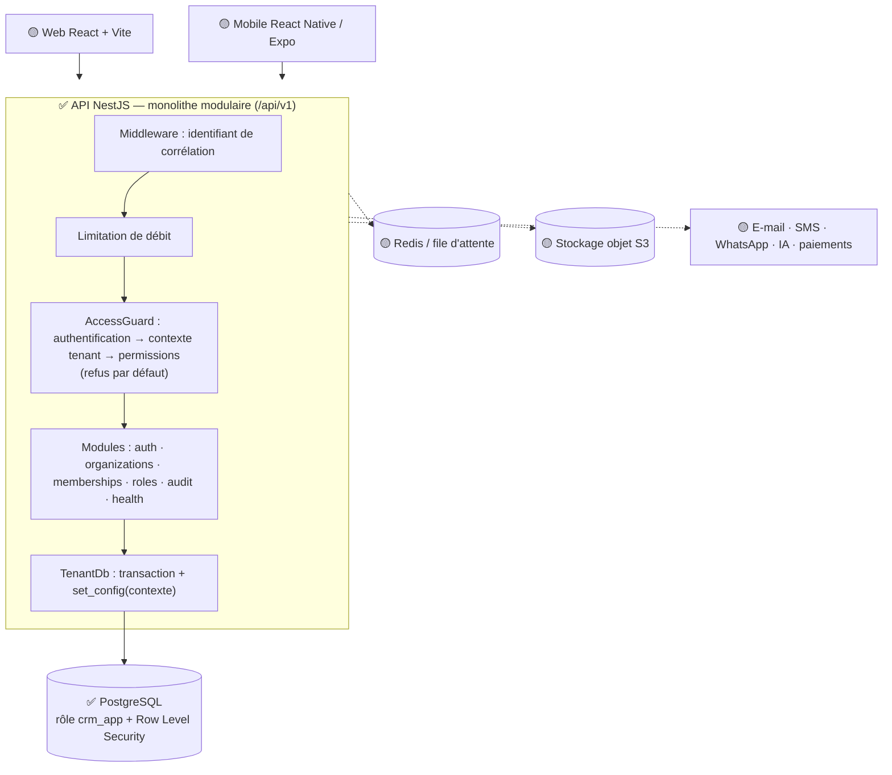
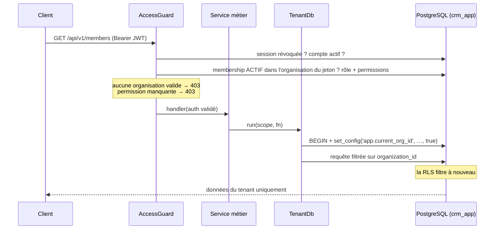

# 02 — Architecture

> Légende : ✅ implémenté et testé · 🟡 prévu, non implémenté. Rien de ce qui est marqué 🟡 n'existe dans le code.

## 1. Vue d'ensemble



## 2. Style : monolithe modulaire

Un seul déployable, découpé par domaines métier (cahier §5.2). Règles de dépendance :

- Un module n'accède **jamais** aux tables d'un autre module : il passe par son service exporté.
- Les modules métier n'ont accès à la base que par `TenantDb` (transaction avec contexte tenant).
  Le client Prisma brut est réservé à `database/`, `auth/`, `health/` et `cli/` — vérifié par
  [architecture.spec.ts](../../apps/api/src/architecture.spec.ts).
- Les intégrations externes sont des **ports** (classe abstraite) + **adaptateurs**. Exemple existant :
  `Mailer` et son adaptateur de développement `LogMailer`.

Extraction d'un service uniquement sur besoin mesuré (charge, isolation, disponibilité).

## 3. Structure du dépôt

État réel aujourd'hui (les dossiers 🟡 n'existent pas encore, volontairement) :

```text
CRM/
  apps/
    api/                      ✅ API NestJS
      src/
        config/               validation de la configuration (zod), fail fast
        database/             PrismaService (brut) + TenantDb (contexte tenant)
        common/               politique d'accès, erreurs, pagination, validateurs, contexte de requête
        modules/
          auth/               inscription, sessions, jetons, garde d'accès
          organizations/      profil, création, provisionnement (rôles système)
          memberships/        membres + invitations
          roles/              rôles personnalisés
          permissions/        catalogue (source de vérité)
          audit/              journal d'audit
          mail/               port Mailer + adaptateur de développement
          health/             sondes live / ready
        cli/seed.ts           données de démonstration (développement)
      test/                   tests d'intégration (HTTP + PostgreSQL réel)
    web/                      🟡 phase 1b
    mobile/                   🟡 phase 10
    worker/                   🟡 phase 7
  packages/                   🟡 créé quand le web partagera types/validateurs
  prisma/
    schema.prisma             ✅ tables de la phase 1
    migrations/               ✅ init + isolation (RLS, privilèges)
    sync-permissions.ts       ✅ catalogue de permissions → base
  scripts/                    ✅ base locale embarquée, tests, génération du .env
  docs/                       ✅ architecture, décisions (ADR), rapports de phase
```

Écart assumé avec le §5.4 du cahier : un dossier n'est créé que lorsqu'il contient du code réel.

## 4. Pile technique

| Couche | Choix | État |
| --- | --- | --- |
| Langage | TypeScript strict (`strict`, `noUncheckedIndexedAccess`) | ✅ |
| API | NestJS 12, Express 5, préfixe `/api/v1` (versionnement par URI) | ✅ |
| ORM / migrations | Prisma 6 ; SQL manuel pour RLS, privilèges, index partiels | ✅ |
| Base | PostgreSQL 16+ (testé sur 18) | ✅ |
| Validation | DTO `class-validator` (liste blanche stricte) ; `zod` pour la configuration | ✅ |
| Authentification | Argon2id, JWT HS256 court (15 min), jeton de rafraîchissement opaque à rotation | ✅ |
| Documentation API | Swagger / OpenAPI sur `/api/docs` | ✅ |
| Tests | Jest + supertest contre un vrai PostgreSQL | ✅ |
| Qualité | ESLint (règles typées), Prettier | ✅ |
| Limitation de débit | `@nestjs/throttler`, **compteurs en mémoire** (une seule instance) | ✅ limité |
| Cache / files | Redis + BullMQ, ou file PostgreSQL (à trancher) | 🟡 phase 7 |
| Temps réel | SSE ou Socket.IO | 🟡 |
| Fichiers | Stockage compatible S3 | 🟡 phase 2 |
| Web | React, Vite, Tailwind, shadcn/ui, TanStack Query, Zustand, RHF + Zod | 🟡 phase 1b |
| Mobile | React Native, Expo | 🟡 phase 10 |

Prisma est volontairement en version 6 : la version 7 change le générateur et le chargement de
configuration ; la montée de version sera une tâche isolée.

## 5. Cycle d'une requête



Rien n'est mis en cache dans cette chaîne : une révocation de session, un retrait de membre ou un
changement de rôle prend effet à la requête suivante (testé). Le coût est de deux allers-retours en
base par requête ; un cache court pourra être ajouté **après mesure**.

## 6. Conventions d'API

- Erreurs : `{ "error": { "code", "message", "details?", "requestId" } }` — `code` est stable et destiné aux clients.
- Listes : pagination par curseur `?limit=&cursor=` → `{ items, nextCursor }`.
- Corps de requête : toute propriété non déclarée dans le DTO est rejetée (400).
- En-tête `x-request-id` accepté (si bien formé) ou généré, renvoyé dans la réponse et dans l'audit.
- `Idempotency-Key` : prévu pour les opérations financières (phase 4), **non implémenté**.

## 7. Hébergement sans VPS

Contrainte confirmée : pas de serveur auto-géré. L'architecture reste compatible parce que :

| Brique | Besoin | Option managée | Point d'attention |
| --- | --- | --- | --- |
| API | Un processus Node.js permanent | Hébergement Node.js géré ou PaaS | Vérifier que l'offre garde le processus actif (pas de mise en veille) |
| PostgreSQL | Rôles + RLS | PostgreSQL géré (ex. Neon) | Le rôle d'exécution ne doit pas avoir `BYPASSRLS` : l'API le vérifie au démarrage et refuse de démarrer sinon |
| Pool de connexions | Mode transaction | PgBouncer du fournisseur | Compatible : le contexte tenant est posé **par transaction** (`set_config(..., true)`), jamais par session |
| Migrations | Connexion directe | `DATABASE_MIGRATION_URL` | Déjà séparée de la connexion d'exécution |
| Files / workers | Processus permanent | Dans le même processus que l'API au départ | À trancher en phase 7 (Redis géré ou file PostgreSQL) |
| Fichiers | S3 | Stockage objet géré | Phase 2 |

Rien de ceci n'est déployé : **aucun déploiement n'a été effectué ni testé**. Le choix de l'hébergeur
est une décision ouverte (A1). Détails et alternatives : [ADR-0004](../decisions/ADR-0004-hebergement-sans-vps.md).

En développement, aucun Docker n'est requis : `npm run db:start` lance un vrai PostgreSQL embarqué
([ADR-0005](../decisions/ADR-0005-postgresql-embarque.md)).

## 8. Sécurité transverse

| Mesure | État |
| --- | --- |
| En-têtes de sécurité (helmet), `x-powered-by` retiré | ✅ |
| CORS limité à une liste d'origines | ✅ |
| Validation stricte des entrées, liste blanche | ✅ |
| Requêtes SQL paramétrées uniquement (`$queryRawUnsafe` interdit par test) | ✅ |
| Secrets hors Git, `.env` généré localement | ✅ |
| Jetons (rafraîchissement, e-mail, invitation) stockés sous forme d'empreinte SHA-256 | ✅ |
| Verrouillage de compte + limitation de débit des routes sensibles | ✅ |
| Journal d'audit en ajout seul | ✅ |
| HTTPS | 🟡 assuré par l'hébergeur ; HSTS déjà émis |
| MFA, protection CSRF (si cookies), antivirus des fichiers, chiffrement des secrets d'intégration | 🟡 |
| Sauvegardes, restauration testée, supervision, alertes | 🟡 phase 11 |
