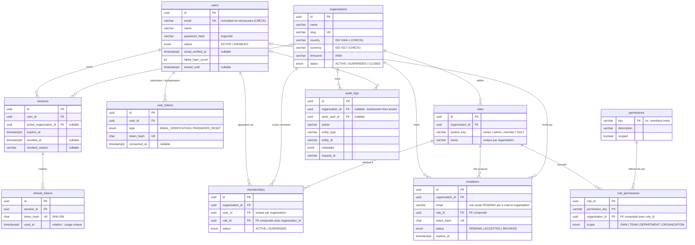
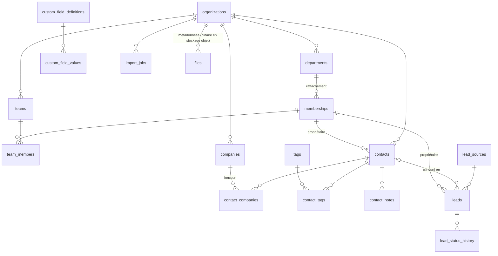
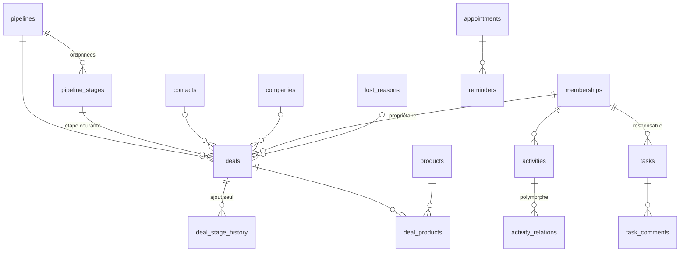
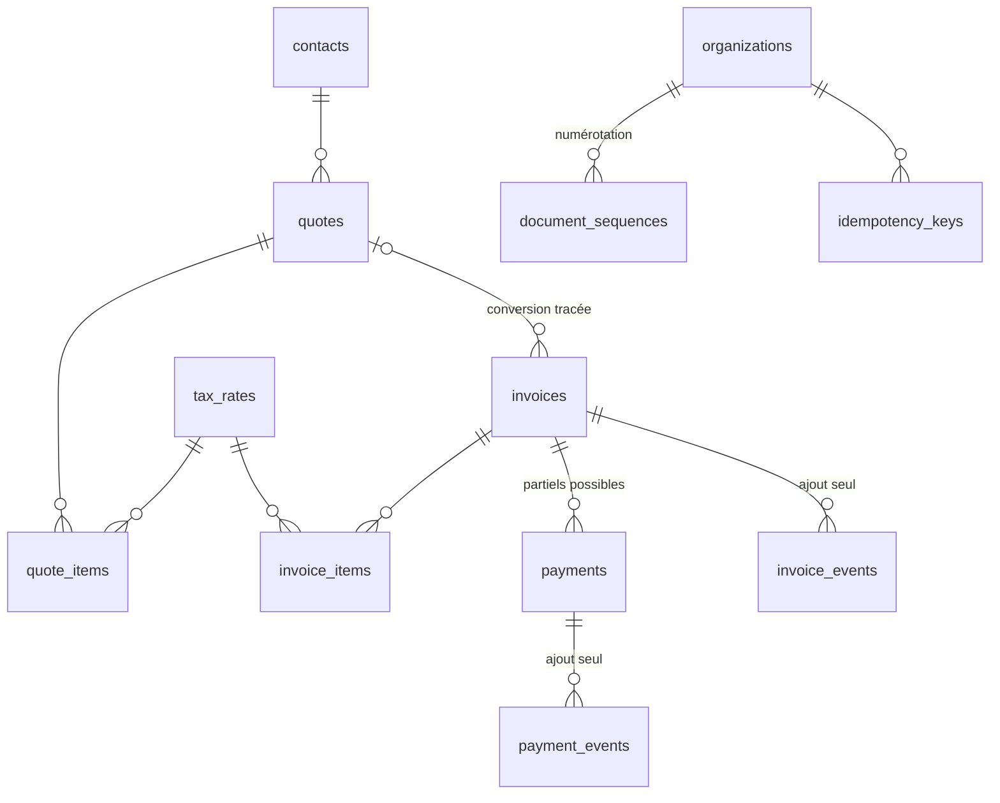
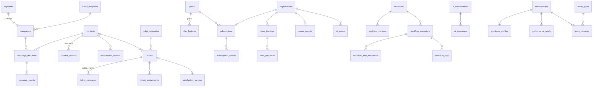

# 03 — Modèle de données et ERD

Deux niveaux de précision, volontairement distincts :

1. **Phase 1 — implémenté.** Diagramme exact, conforme à [schema.prisma](../../prisma/schema.prisma)
   et aux migrations appliquées.
2. **Phases suivantes — cible.** Diagrammes par domaine servant de plan. Ces tables **n'existent
   pas** ; champs, nullabilités et contraintes seront figés dans la migration de leur phase
   (cahier §6.3, dernier paragraphe).

## 1. Conventions (appliquées en phase 1, obligatoires ensuite)

| Règle | Détail |
| --- | --- |
| Identifiants | UUID générés par PostgreSQL (`gen_random_uuid()`) |
| Horodatage | `timestamptz` en UTC ; `created_at` partout, `updated_at` sur les entités modifiables |
| Tenant | `organization_id NOT NULL` + index sur toute table d'organisation |
| Relations intra-tenant | **Clé étrangère composite** `(organization_id, x_id) → (organization_id, id)` : la base refuse de lier deux entités d'organisations différentes |
| Unicité | Toujours composée avec `organization_id` (ex. nom de rôle) |
| RLS | `ENABLE` + `FORCE` + policies dans la migration SQL de la table |
| Privilèges | `GRANT` explicites et minimaux au rôle `crm_app` |
| Montants | `NUMERIC` + colonne devise ISO 4217, jamais de flottant (à partir de la phase 3) |
| Suppression logique | `deleted_at` seulement là où le métier l'exige |
| Historique | Tables d'événements en ajout seul pour l'audit, les paiements, les changements d'étape |

## 2. Phase 1 — implémenté ✅

### Nature des tables

| Table | Portée | RLS | Droits de `crm_app` |
| --- | --- | --- | --- |
| `users`, `sessions`, `refresh_tokens`, `user_tokens` | Globale (identité) | Non | SELECT, INSERT, UPDATE |
| `permissions` | Globale (catalogue) | Non | SELECT seulement |
| `organizations` | Tenant (racine) | Oui | SELECT, INSERT, UPDATE |
| `roles`, `role_permissions`, `memberships`, `invitations` | Tenant | Oui | SELECT, INSERT, UPDATE, DELETE |
| `audit_logs` | Tenant | Oui | SELECT, INSERT (**ajout seul**) |

### Écarts par rapport au §6.2 du cahier

| Écart | Raison |
| --- | --- |
| Tables ajoutées : `sessions`, `refresh_tokens`, `user_tokens`, `invitations` | Nécessaires à la révocation de session, à la vérification d'e-mail, à la réinitialisation et à l'ajout de membres |
| `permissions.key` sert de clé primaire (pas d'`id`) | La clé est l'identifiant stable utilisé par le code |
| `role_permissions.scope` et `organization_id` ajoutés | Portées RBAC (§8.2) et RLS |
| `roles.system_key` ajouté | Distinguer les rôles système non modifiables |
| `teams`, `team_members`, `departments` absents | Créés en phase 2, quand la portée `TEAM`/`DEPARTMENT` s'appliquera à des ressources réelles |

## 3. Cible — phases suivantes 🟡 (non implémenté)

Toutes les tables ci-dessous portent `organization_id` (sauf mention « global ») et suivront les
conventions du §1. Seules les relations structurantes sont montrées.

### Phase 2 — Équipes, contacts, entreprises, leads

Précisions par rapport au cahier :

- `team_members` référence `memberships` (et non `users`) : l'appartenance à une équipe n'a de sens
  que dans une organisation.
- Le propriétaire d'une ressource (`owner_…`) référence un **membership** de la même organisation
  via FK composite, pas un utilisateur global.
- `custom_field_values` et, plus tard, `activity_relations` sont **polymorphes** (`entity_type`,
  `entity_id`) : pas de clé étrangère possible. L'isolation repose alors sur `organization_id` +
  RLS, et l'existence de la cible est vérifiée dans la transaction.
- Ajouts nécessaires non listés au §6.2 : `lead_status_history`, `import_jobs`, `files`,
  `saved_views`.

### Phase 3 — Pipelines, opportunités, activités, tâches

### Phase 4 — Devis, factures, paiements (clients du CRM)

Ajouts : `document_sequences` (numérotation sans trou, verrouillée), `invoice_events`,
`payment_events`, `idempotency_keys`, `webhook_events` (déduplication). Strictement séparé des
tables SaaS de l'éditeur.

### Phases 5 à 9 — Marketing, support, abonnements SaaS, automatisations, IA, RH

`plans`, `plan_features` et `coupons` sont globaux (gérés par l'éditeur, lecture seule pour
`crm_app`). `knowledge_articles`, `webhook_endpoints`, `ai_provider_configs`,
`ai_knowledge_sources`, `performance_records` complètent ces domaines comme décrit au §6.2.

## 4. Procédure pour ajouter une table tenant

1. Modèle Prisma avec `organizationId`, `@@unique([organizationId, id])` et relations composites.
2. `npx prisma migrate diff` pour générer le SQL, puis **ajouter à la main** dans la même migration :
   `ENABLE` / `FORCE ROW LEVEL SECURITY`, les policies, les `GRANT`.
3. Lancer `npm test` : [rls.e2e-spec.ts](../../apps/api/test/rls.e2e-spec.ts) échoue tant que la
   table n'a pas de RLS forcée, et sa liste de tables attendues doit être mise à jour consciemment.
4. Ajouter les tests d'accès croisé du module.
